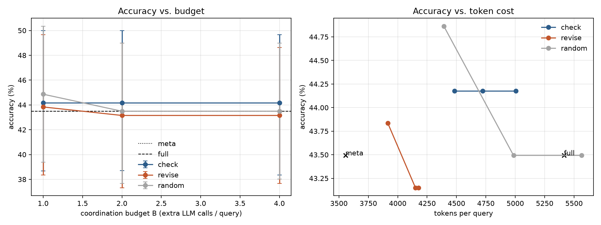
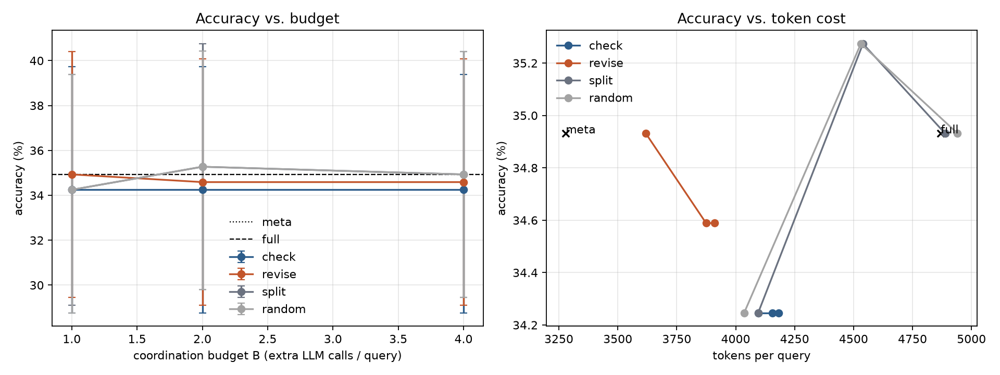

# AOP-Budget: checking versus revision under a coordination-call allowance

COE549 Advanced LLM final project - Rayan Azzam.

Independent reimplementation of Agent-Oriented Planning (AOP), extended
with a coordination-budget controller and per-stage cost accounting.

## Corrected evaluation

The corrected grid contains 27 configurations: 12 GPT-4o and 15 GPT-4o-mini.
Every configuration uses the same 292 HuskyQA test questions, giving
7,884 question-condition outcomes.

| Model | Meta | Routing only | Full implementation | Full token overhead vs meta |
|---|---|---|---|---|
| GPT-4o | 43.5% | 44.2% | 43.5% | +52.3% |
| GPT-4o-mini | 34.9% | 33.9% | 34.9% | +48.5% |

No statistically significant accuracy difference was detected between plan checking and subtask revision in the six direct paired comparisons. Checking consumed more tokens in every comparison. No coordinated condition significantly outperformed routing alone under the reported exact McNemar tests. Non-significance does not establish equivalence.

See [RESULTS.md](RESULTS.md) for corrected tables and qualifications.

## Conditions

- `meta`: decomposition, execution, aggregation; no reward-model routing.
- `routing`: reward-model routing without checking or revision.
- `full`: detector and revision procedure without the experimental B
  allowance. Other implementation limits still apply.
- `check`, `revise`, `split`, `random`: coordination allocation policies
  at B = 1, 2, 4.

GPT-4o does not include split conditions. This omission followed inspection
of mini results and is an exploratory design decision.

## Relationship to AOP

This is an independent reimplementation, not an exact reproduction.
Differences include:

- Wikipedia search instead of Bing.
- Substitute reward-model training data.
- Independently written prompts.
- GPT-4o-mini scoring and answer judging.
- Thresholds calibrated on a different scoring scale.
- Frozen representative works during testing.
- No recursive revision of newly created subtasks.
- A reward model trained with mini agents and reused for GPT-4o.

Original paper:
[Agent-Oriented Planning in Multi-Agent Systems](https://arxiv.org/abs/2410.02189).

## Corrected and historical outputs

Use `results_corrected_gpt4o`, `results_corrected_mini`, and
`analysis_corrected`.

The older `results` and `results_gpt4o` folders and their figures are
historical outputs. Do not mix historical and corrected results.

Corrections accept detector changes to assignments and dependencies,
normalize scalar dependency fields, prevent extra JSON repair calls during
coordination, and add routing-only controls.

Authentication-failure rows were backed up and retried without selecting
outcomes by correctness.

## Setup

Use Python 3.12 and install dependencies:

    python -m pip install -r requirements.txt
    python -m pytest -q

Provide the original 292-question `data/huskyqa/test.jsonl`, the saved model
and thresholds in `models`, and local API configuration in `.env`.
Never commit credentials or caches.

## Reproduce evaluation

These commands can incur API charges. Identical cached calls are reused
when the original caches are available. Corrected reruns are not
independent replications.

    python scripts/sweep.py --provider openai --model gpt-4o-mini --judge-model gpt-4o-mini --search wikipedia --embedder minilm --workers 2 --results-dir results_corrected_mini

    python scripts/sweep.py --provider openai --model gpt-4o --judge-model gpt-4o-mini --search wikipedia --embedder minilm --policies check,revise,random --workers 2 --results-dir results_corrected_gpt4o

Saved rows resume automatically. Provenance manifests guard against
mixing incompatible code or configurations.

## Offline analysis

These commands make no paid API calls:

    python scripts/analyze.py --run huskyqa_test --results-dir results_corrected_mini

    python scripts/analyze.py --run huskyqa_test --results-dir results_corrected_gpt4o

    python scripts/compare_policies.py --mini-dir results_corrected_mini/huskyqa_test --gpt4o-dir results_corrected_gpt4o/huskyqa_test --out analysis_corrected

## Scope limits

Development included inspection of test traces. Model aliases rather than
exact model snapshots were recorded. Shared cached generations do not
provide independent replications. Findings concern this benchmark,
implementation, and model pair.

Analysis followed observation of outcomes; no preregistration is claimed.

The code agent executes generated Python in a subprocess.
It is not a security sandbox.

## Interpretation and accounting

- B is a maximum allowance of coordination calls. It does not match
  realized calls, tokens, dollars, or wall-clock time. Policies can stop early.
- Token totals include pipeline prompt and completion tokens, including
  cached calls at their original token counts.
- Evaluation calls and reward-model CPU overhead are excluded.
- Reward-model routing uses CPU computation but no LLM API call.
- Changed plans can change execution costs.
- Summed historical LLM latency excludes search time and is not measured
  end-to-end runtime.
- Direct tests use Holm correction across six comparisons.
- Exploratory routing comparisons use a separate Holm correction across
  23 comparisons.
- Bootstrap intervals are pointwise percentile intervals, not simultaneous
  intervals. With few discordant outcomes, they can disagree with exact
  tests. Significance claims follow the reported exact tests.
- Numerical proximity does not diagnose factual drift or an error's cause.
  The secondary numeric metric counts recorded correctness OR first-number
  proximity within 5%.
- Task-text plan-change counts exclude changes solely to assignments
  or dependencies.
- Detector edit percentages are per detector call, not per question.
- Recorded-output checks do not establish that every internal agent/tool
  action succeeded or that every judge label is correct.
- Trace-level review remains separate.
