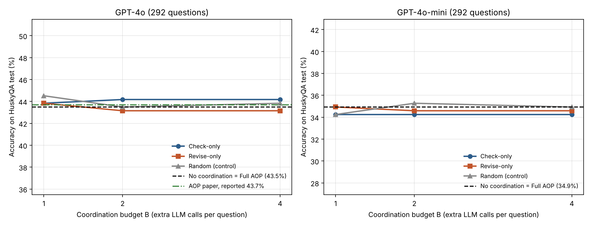

# AOP-Budget: plan checking vs. sub-task revision under a coordination budget

COE549 Advanced LLM final project, Rayan Azzam.

This is a reimplementation of **Agent-Oriented Planning (AOP)** (Li et al., ICLR 2025,
arXiv:2410.02189), extended with a **coordination-budget controller**.

**Research question.** Suppose each query gets a fixed budget of *B* extra coordination
LLM calls. Is it better to spend them on **plan checking** (the detector) or on **sub-task
revision** (replan, re-describe, plan-in-detail)?

## Results at a glance



| HuskyQA test (292 q.) | GPT-4o | GPT-4o-mini |
|---|---|---|
| AOP paper, reported (GPT-4o) | 43.7% | – |
| **Full AOP (this reimplementation)** | **43.5%** | 34.9% |
| **No coordination (`meta`)** | **43.5%** | 34.9% |
| Best budgeted condition | 44.5% (random, B=1) | 35.3% (split/random, B=2) |
| Extra tokens, full AOP vs. `meta` | +50% | +48% |

- The reimplementation reproduces AOP's reported accuracy, but a plain decomposition
  baseline reaches the same accuracy without any coordination.
- Under every budget (B = 1, 2, 4), neither plan checking nor sub-task revision improves
  accuracy on either model (all differences n.s., p ≥ 0.55). Coordination changes up to
  63% of plans but fixes as many answers as it breaks, at up to +50% tokens.

Full tables, statistics and findings: **[RESULTS.md](RESULTS.md)**.

## How the code maps to the paper

| Paper (AOP) | Code |
|---|---|
| Meta-agent: fast decomposition and allocation (§4.1) | `aop/pipeline.py` `AOP.decompose` |
| Reward model M_θ(q, d) = MLP([E(q); E(d)]), MSE training (§4.2, Eq. 2–4) | `aop/reward_model.py`, `scripts/collect_rm_data.py`, `scripts/train_reward_model.py` |
| Representative works and similarity (§4.3, Eq. 5) | `aop/reward_model.py` `RepresentativeWorks` |
| Re-describe / plan-in-detail / replan (§4.3) | `AOP.revise` |
| Detector: completeness and non-redundancy (§4.4) | `AOP.check` |
| Code, math, search and commonsense agents | `aop/agents.py`, `aop/search.py` |
| GPT-4o answer judge | `aop/evaluate.py` |
| **New: budget controller** (meta, full, check, revise, split, random) | `AOP.coordinate` |
| **New: per-stage cost ledger** (calls, tokens, latency) | `aop/ledger.py` |

### Budget accounting

The budget *B* applies only to **coordination** calls:

- **Check**: one detector call. It may rewrite the plan.
- **Revise**: one call that fixes the riskiest flagged sub-task.

The following are fixed costs and are not counted against *B*: decomposition (1 call),
agent execution, and aggregation (1 call). Re-assigning a sub-task to the reward model's
best agent is free (it is an MLP, not an LLM call), so every condition except `meta` gets it.

| Condition | Meaning |
|---|---|
| `meta` | Meta-Agent baseline: decompose, execute, aggregate. No reward model, no checks. |
| `full` | AOP as published: detector rounds, then every flagged sub-task is revised. No cap. |
| `check_B{1,2,4}` | All *B* calls go to the detector. |
| `revise_B{1,2,4}` | All *B* calls go to revision, lowest reward-model score first. |
| `split_B{1,2,4}` | Alternates check, revise, check, … |
| `random_B{1,2,4}` | Picks check or revise at random. A control for "any extra call helps". |

### Deviations from the paper (state these in the report)

1. **Backbone.** The main results use GPT-4o, as in the paper; GPT-4o-mini is the second
   model. The answer judge and the reward-model scorer are GPT-4o-mini in both runs. The
   reward model was trained with GPT-4o-mini agents and reused for GPT-4o.
2. **Search.** The Bing Search API was retired in Aug 2025. Search uses Wikipedia (free)
   by default, or Tavily or Serper. All results are cached.
3. **Thresholds.** The paper does not report τ. Tune `--tau-high`, `--tau-low` and
   `--tau-sim` on the train split (see step 4 below).
4. **Prompts.** Written from the paper's descriptions, not copied from its appendix.
5. **Feedback loop.** Representative works are frozen during test runs, so conditions are
   compared on equal terms. In the paper they keep growing during the run.
6. **Revision.** Sub-tasks created by a revision are re-routed to an agent but not revised
   again. This keeps cost bounded.
7. **Reward-model training data.** The public HuskyQA release has only the 292-question test
   set, so the reward model is trained on a 1,440-question mix of HotpotQA, GSM8K, Bamboogle
   and StrategyQA (`data/rm_train/`, details in its README) instead of HuskyQA's training split.
8. **Scorer and thresholds.** With GPT-4o-mini, the paper-style scorer gave 85% of answers
   5/5, so the reward model had nothing to learn. A stricter scorer that takes the agent's
   tools into account is used instead (`prompts.SCORER_SYSTEM`; the lenient version is kept
   for reference). The thresholds are set by quantiles on held-out sub-tasks, and the MLP
   uses early stopping and weight decay.

## What you need to do

### 0. Setup (about 10 min)

```bash
git clone <your repo> && cd aop-budget
python -m venv .venv && source .venv/bin/activate      # Windows: .venv\Scripts\activate
pip install -r requirements.txt
cp .env.example .env        # then edit .env (step 1)
python -m pytest -q         # 14 tests, offline, should all pass
```

### 1. Get an LLM API key and put it in `.env`

Any one of these works:

- **OpenAI** (closest to the paper): GPT-4o (main) or GPT-4o-mini (cheaper).
  `LLM_PROVIDER=openai`, `LLM_MODEL=gpt-4o-mini`, `LLM_API_KEY=sk-...`
- **Free options** through OpenAI-compatible endpoints. These have tight rate limits, so
  use `--workers 2`.
  - Google Gemini: `LLM_BASE_URL=https://generativelanguage.googleapis.com/v1beta/openai/`
  - Groq: `LLM_BASE_URL=https://api.groq.com/openai/v1`

  Check each provider's current model names.

Until you have a key, everything runs with `LLM_PROVIDER=mock`. The mock's numbers are
meaningless; it only checks that the code works.

### 2. Get the data

```bash
pip install huggingface_hub pandas pyarrow
python scripts/download_data.py          # -> data/huskyqa/test.jsonl (292 questions)
```

If that fails, download HuskyQA by hand from <https://huggingface.co/agent-husky> and run
`python scripts/download_data.py --from-file <file> huskyqa test`.
Only the 292-question test set is public; the reward-model training pool ships in `data/rm_train/`.

### 3. Smoke test with a real model (a few cents)

First check that search works from your machine: `python scripts/check_search.py`.


```bash
python scripts/run_experiment.py --dataset sample --policy meta --workers 2
```

Then open `results/sample_test/meta.jsonl` and read a few traces: the plan, each agent's
answer, and the final answer. **Fix prompts now if something looks wrong.**

### 4. Reward model

```bash
python scripts/collect_rm_data.py --limit 300 --workers 4   # agents answer + scorer grades (~$0.30)
python scripts/rescore_rm_data.py                            # only if data was graded with the old lenient scorer
python scripts/train_reward_model.py --data data/rm/rm_data_strict.jsonl
```

The training script uses early stopping and weight decay, so it does not over-fit. It
**calibrates the thresholds** on held-out sub-tasks: by default about 30% are flagged for
revision and 5% are replanned, and τ_sim is set so that half of the revisions are
re-describe and half are plan-in-detail. It saves these to `models/thresholds.json`, which
every experiment then uses. Check two lines in its output:

- **"flagged ... should be LOWER"**: flagged sub-tasks should really be the weaker ones.
- **"RM picks the better agent"**: should be above 50% (chance).

### 5. Pilot sweep, then the full sweep

To reproduce the paper results exactly:

```bash
python scripts/sweep.py --workers 4                                   # GPT-4o-mini, 14 conditions
python scripts/sweep.py --model gpt-4o --judge-model gpt-4o-mini \
    --policies check,revise,random --results-dir results_gpt4o --workers 4   # GPT-4o, 11 conditions
python scripts/analyze.py --run huskyqa_test
python scripts/analyze.py --run huskyqa_test --results-dir results_gpt4o
python scripts/make_figures.py
```

Pilot first, if you are starting from scratch:

```bash
python scripts/sweep.py --limit 50 --workers 8     # pilot on 50 test queries
python scripts/analyze.py --run huskyqa_test       # table + plot
python scripts/sweep.py --workers 8                # all 292 (resumes and reuses the cache)
python scripts/analyze.py --run huskyqa_test
```

This writes `results/huskyqa_test/summary.md` (accuracy with 95% CI, McNemar tests vs.
`meta` and `full`, calls, tokens, latency, and process statistics) and
`accuracy_vs_budget.png`. These go straight into the slides and the paper.

### Optional extras for the final paper

- **H2 (weaker executor):** run the sweep again with a smaller model:
  `--model <small model> --tag small`.
- **Transfer:** run on DROP or IIRC. Use `download_data.py --all`, then
  `--dataset drop --limit 200`.
- **Variance:** repeat with `--seed 1` and `--seed 2`. The seed salts the cache, so each
  run makes fresh calls.

## Cost and time

The complete project (reward-model data, both models, all conditions, pilots) cost about
**$8** in OpenAI API fees. The LLM cache (`.cache/llm.sqlite`) means a re-run of an
existing experiment costs nothing. A full 292-question sweep takes about 30–60 min with
`--workers 4`, mostly limited by the Wikipedia rate limit.

## Safety note

The code agent executes Python written by the model, using `python -I` in a temp directory
with a timeout. That is **not** a security sandbox. Run the project in a VM or container if
that worries you.

## Layout

```
aop/            library: llm, ledger, agents, search, plan, reward_model, pipeline, evaluate
scripts/        download_data, check_search, collect_rm_data, rescore_rm_data, train_reward_model,
                run_experiment, sweep, analyze, show_traces, make_figures
tests/          offline unit tests (mock LLM)
results/        GPT-4o-mini results (one JSONL per condition)
results_gpt4o/  GPT-4o results
models/         trained reward model, representative works, thresholds
figures/        figure used in README / paper / slides
data/sample/    12 hand-written smoke-test questions (not a benchmark)
```
