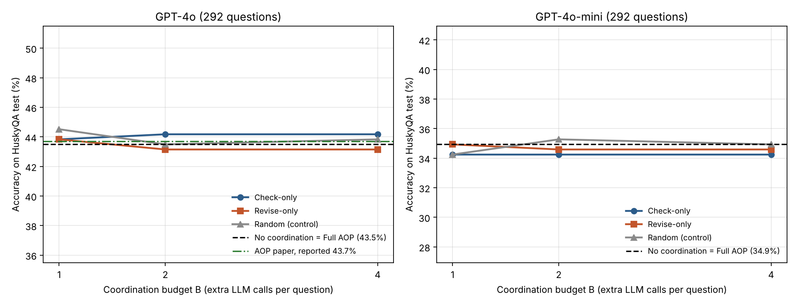

# Results

All numbers are on the full HuskyQA test set (292 questions). Every condition answers the
**same** questions, so comparisons are paired. *Wrong→right* / *right→wrong* count questions
that a condition answered differently from `meta` (no coordination); *McNemar p* is an
exact two-sided test on those flips. 95% CIs are bootstrap intervals (2,000 resamples).
Tokens are prompt + completion per question. The grader is GPT-4o-mini in both runs.

## GPT-4o (HuskyQA test, 292 questions)

| Condition | Accuracy | 95% CI | Extra coord. calls | Tokens / question | vs. meta | Wrong→right | Right→wrong | McNemar p |
|---|---|---|---|---|---|---|---|---|
| meta | 43.5% | 38.0–49.0 | 0.00 | 3,555 | – | – | – | – |
| full | 43.5% | 38.0–49.3 | 2.21 | 5,338 | +50% | 9 | 9 | 1.00 |
| check_B1 | 43.8% | 38.0–49.3 | 1.00 | 4,484 | +26% | 7 | 6 | 1.00 |
| check_B2 | 44.2% | 38.4–50.0 | 1.16 | 4,646 | +31% | 7 | 5 | 0.77 |
| check_B4 | 44.2% | 38.4–50.0 | 1.26 | 4,766 | +34% | 7 | 5 | 0.77 |
| revise_B1 | 43.8% | 38.4–49.3 | 0.60 | 3,915 | +10% | 7 | 6 | 1.00 |
| revise_B2 | 43.2% | 37.7–48.6 | 0.96 | 4,151 | +17% | 7 | 8 | 1.00 |
| revise_B4 | 43.2% | 37.7–48.6 | 1.00 | 4,176 | +17% | 7 | 8 | 1.00 |
| random_B1 | 44.5% | 38.7–50.0 | 1.00 | 4,393 | +24% | 9 | 6 | 0.61 |
| random_B2 | 43.5% | 38.0–49.3 | 1.67 | 4,949 | +39% | 11 | 11 | 1.00 |
| random_B4 | 43.8% | 38.4–49.3 | 2.26 | 5,433 | +53% | 10 | 9 | 1.00 |

## GPT-4o-mini (HuskyQA test, 292 questions)

| Condition | Accuracy | 95% CI | Extra coord. calls | Tokens / question | vs. meta | Wrong→right | Right→wrong | McNemar p |
|---|---|---|---|---|---|---|---|---|
| meta | 34.9% | 29.5–40.4 | 0.00 | 3,271 | – | – | – | – |
| full | 34.9% | 29.5–40.4 | 1.96 | 4,843 | +48% | 6 | 6 | 1.00 |
| check_B1 | 34.2% | 28.8–39.7 | 1.00 | 4,087 | +25% | 3 | 5 | 0.73 |
| check_B2 | 34.2% | 28.8–39.7 | 1.04 | 4,132 | +26% | 3 | 5 | 0.73 |
| check_B4 | 34.2% | 28.8–39.7 | 1.04 | 4,139 | +27% | 3 | 5 | 0.73 |
| revise_B1 | 34.9% | 29.5–40.4 | 0.55 | 3,606 | +10% | 4 | 4 | 1.00 |
| revise_B2 | 34.6% | 29.5–40.1 | 0.86 | 3,859 | +18% | 5 | 6 | 1.00 |
| revise_B4 | 34.6% | 29.5–40.1 | 0.91 | 3,895 | +19% | 5 | 6 | 1.00 |
| split_B1 | 34.2% | 28.8–39.7 | 1.00 | 4,087 | +25% | 3 | 5 | 0.73 |
| split_B2 | 35.3% | 29.8–40.8 | 1.57 | 4,521 | +38% | 5 | 4 | 1.00 |
| split_B4 | 34.9% | 29.5–40.4 | 1.96 | 4,843 | +48% | 6 | 6 | 1.00 |
| random_B1 | 34.2% | 28.8–39.7 | 1.00 | 4,027 | +23% | 3 | 5 | 0.73 |
| random_B2 | 35.3% | 29.8–40.8 | 1.57 | 4,512 | +38% | 5 | 4 | 1.00 |
| random_B4 | 34.9% | 29.5–40.4 | 2.02 | 4,890 | +50% | 6 | 6 | 1.00 |

## Key findings

1. **Reproduction.** Full AOP with GPT-4o reaches **43.5%**; the paper reports **43.7%**.
2. **No-coordination baseline matches it.** The plain decomposition baseline (`meta`) also
   reaches **43.5%** with GPT-4o (the paper's Meta-Agent baseline: 30.0%).
3. **No budget allocation helps.** Check-only, revise-only, split and random allocation at
   B = 1, 2, 4 all fall within ±1.3 points of `meta`; no difference is significant
   (all p ≥ 0.55).
4. **Coordination changes a lot but fixes nothing on net.** With GPT-4o, full AOP changed
   183/292 plans (63%) and flipped 9 answers to correct and 9 to incorrect.
5. **It costs.** Full AOP uses ~50% more tokens than `meta` on both models.
6. **Plan checking saturates.** The detector changed the plan on 16–23% (GPT-4o) and 4–5%
   (GPT-4o-mini) of questions; after it reports "plan OK", extra checking budget is unused.
7. **Same pattern on both models.** A stronger model adds ~9 points; coordination adds none.

| Hypothesis | Result |
|---|---|
| H1: at small budgets, plan checking beats sub-task revision | not supported |
| H2: revision helps more with a weaker executor | not supported |
| H3: equal call budgets are not equal costs | supported (1 check ≈ +26% tokens; revision ≈ +10–19%) |

## Error profile (GPT-4o-mini, `meta`)

Of the wrong answers, about 40% are within 10% of the gold value (facts that changed
since HuskyQA was written, edition differences), and many others come from retrieval or
unit/scale mistakes, errors that plan-level coordination does not address. The
`acc ±5%` column in `scripts/analyze.py` output quantifies this.

Regenerate everything with `python scripts/analyze.py --run huskyqa_test` (and
`--results-dir results_gpt4o`) and `python scripts/make_figures.py`.
